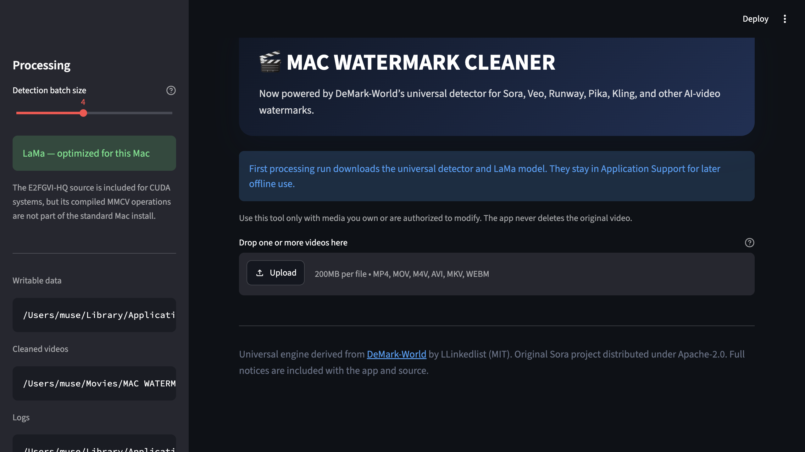

# MAC WATERMARK CLEANER

MAC WATERMARK CLEANER is powered by the newer
[DeMark-World](https://github.com/linkedlist771/DeMark-World) engine. It keeps
the familiar, simple workflow while using DeMark-World's universal detector for
watermarks from Sora, Veo, Runway, Pika, Kling, and other AI-video tools.



The Mac app:

- never deletes or overwrites an original video;
- saves cleaned copies to `~/Movies/MAC WATERMARK CLEANER`;
- keeps Python, models, caches, logs, and settings under
  `~/Library/Application Support/MAC WATERMARK CLEANER`;
- does not write mutable files inside `/Applications`;
- downloads the private Python 3.12 runtime and model files only when needed;
- uses LaMa by default on Apple Silicon;
- retains the E2FGVI-HQ source for supported CUDA installations, while clearly
  treating MMCV/CUDA as optional on macOS.

Use the tool only with media you own or are authorized to modify.

## Install the Mac app

1. Download `MAC-WATERMARK-CLEANER-macOS-arm64-v1.0.3.zip` from the GitHub
   release.
2. Unzip it and drag **MAC WATERMARK CLEANER.app** to Applications.
3. Open the app. First setup needs internet access and may take several minutes.
4. Drop in videos and choose **Remove Watermarks**.

The release uses an ad-hoc signature because it is not Apple-notarized. If
macOS blocks the first launch, use right-click → **Open**. Since Sentinel is
already part of the intended Mac setup, Sentinel can also be used as the
Gatekeeper fallback for this trusted GitHub download. Sentinel is not bundled
with this project.

Large detector and LaMa files download on the first processing run. They remain
in Application Support so later runs can work offline.

## Build and verify

Requirements: macOS 14+, Apple Silicon, Xcode Command Line Tools, and `uv`.
The build script can use the `uv` copy installed with Pinokio. The app uses the
fully pinned and transitively resolved `requirements-macos.lock`; the verified
runtime is managed CPython 3.12.13.

```bash
./script/build_macos_app.sh
./script/build_and_run.sh --verify
```

Build outputs:

- `dist/MAC WATERMARK CLEANER.app`
- `dist/MAC-WATERMARK-CLEANER-macOS-arm64-v1.0.3.zip`

To run the dedicated Mac/DeMark tests after the private runtime is provisioned:

```bash
MAC_WATERMARK_RUNTIME_DIR=/tmp/mac-watermark-cleaner-test-runtime \
  dist/MAC\ WATERMARK\ CLEANER.app/Contents/Resources/bootstrap_macos.sh test

dist/MAC\ WATERMARK\ CLEANER.app/Contents/Resources/tools/uv pip install \
  --python /tmp/mac-watermark-cleaner-test-runtime/Python/bin/python \
  -r requirements-macos-test.txt

/tmp/mac-watermark-cleaner-test-runtime/Python/bin/python -m pytest \
  tests/test_macos_branding.py tests/test_macos_upgrade.py
```

The historical CUDA/E2FGVI test directories are retained as upstream source;
they are not claimed as passing in the standard Mac runtime because MMCV/CUDA
is intentionally optional there.

## Source use

```bash
uv venv --python 3.12.13 .venv
uv pip install --python .venv/bin/python -r requirements-macos.lock
PATH="$(.venv/bin/python -c 'import pathlib, imageio_ffmpeg; print(pathlib.Path(imageio_ffmpeg.get_ffmpeg_exe()).parent)'):$PATH" \
  .venv/bin/python -m streamlit run app.py
```

The CLI accepts one file or a folder:

```bash
.venv/bin/python cli.py -i input.mp4 -o output-cleaned.mp4
```

## Licensing and attribution

The original SoraWatermarkCleaner source project remains under Apache License
2.0. The bundle identifier and legacy compatibility aliases retain that
historical name so existing app data and automation keep working; the product
and installed app name are **MAC WATERMARK CLEANER**.
The embedded DeMark-World engine is licensed by its actual repository license
file: MIT, copyright 2025 LLinkedlist. DeMark-World's README currently says
Apache-2.0, but its `LICENSE` file says MIT; this project preserves the MIT text
and attribution explicitly.

See [THIRD_PARTY_NOTICES.md](THIRD_PARTY_NOTICES.md) and
`THIRD_PARTY_LICENSES/` for full details.
